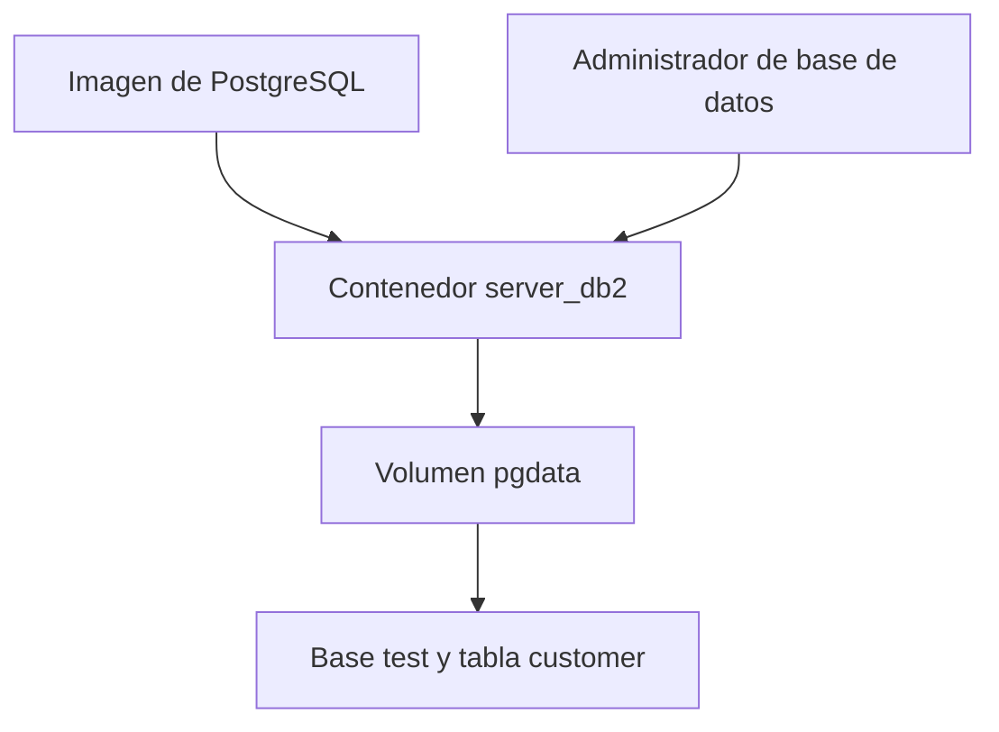

# Práctica No. 3 - Volúmenes en Docker con PostgreSQL

## 1. Título

**Creación de volúmenes para persistir una base de datos PostgreSQL utilizando Docker**

## 2. Tiempo de duración

[Completar con el tiempo real empleado en minutos].

## 3. Fundamentos

### Docker y contenedores

Docker es una plataforma que permite crear y ejecutar aplicaciones dentro de contenedores. Estos entornos incluyen los componentes necesarios para que una aplicación funcione y comparten el núcleo del sistema operativo que los ejecuta. Una imagen contiene la base para crear un contenedor, mientras que el contenedor es una instancia de esa imagen que puede iniciarse, detenerse y eliminarse.

En esta práctica se trabajó con la imagen oficial de PostgreSQL para comparar dos formas de almacenar la información. Se utilizaron los contenedores `server_db1` y `server_db2`, con el propósito de comprobar qué ocurre con una base de datos cuando se elimina y se vuelve a crear el contenedor.

### Base de datos PostgreSQL

PostgreSQL es un sistema de gestión de bases de datos relacionales que permite organizar información en tablas y manipularla mediante instrucciones SQL. Una tabla está formada por columnas, que definen los campos, y filas, que contienen los registros almacenados.

Para desarrollar la actividad se utilizó una base de datos llamada `test` y una tabla denominada `customer`, con los campos `id`, `fullname` y `status`. La conexión mediante un administrador de bases de datos permitió crear estos elementos, insertar información y consultar los registros antes y después de recrear los contenedores.

### Almacenamiento y persistencia

Los archivos almacenados únicamente en la capa de escritura de un contenedor se eliminan junto con él. Detener un contenedor no equivale a eliminarlo: al detenerlo, su almacenamiento permanece disponible para el siguiente inicio. Sin embargo, crear otro contenedor con el mismo nombre no recupera automáticamente el almacenamiento utilizado por el anterior.

La imagen oficial de PostgreSQL declara una ubicación de volumen para sus datos. Por ello, cuando no se configura un volumen propio, Docker puede crear un volumen anónimo. Este puede permanecer después de eliminar el contenedor, pero no se vuelve a asociar automáticamente al crear otro con el mismo nombre. En la primera parte, la ausencia de la base `test` en el nuevo contenedor demuestra que este no recuperó los datos anteriores; no implica necesariamente que todos los archivos se hayan borrado físicamente del equipo.

### Volúmenes de Docker

Un volumen es un recurso de almacenamiento administrado por Docker que tiene un ciclo de vida independiente del contenedor. Al utilizar un volumen con nombre, como `pgdata`, es posible identificarlo y asociarlo nuevamente a otro contenedor. Esto permite conservar la base de datos, las tablas y los registros, siempre que el volumen permanezca disponible y se monte en la ubicación correcta.

La ubicación depende de la versión de la imagen: en PostgreSQL 17 y anteriores se utiliza normalmente `/var/lib/postgresql/data`; en PostgreSQL 18 y posteriores, el montaje recomendado es `/var/lib/postgresql`. Es necesario mantener la misma versión principal de PostgreSQL al recrear el contenedor para esta comprobación, sin introducir una actualización del motor.



*Figura 1. Relación entre el contenedor PostgreSQL, el administrador de base de datos y el volumen de almacenamiento.*

## 4. Conocimientos previos

- Conceptos básicos de imágenes y contenedores.
- Instalación y uso básico de Docker.
- Manejo de comandos en una terminal.
- Comprensión de puertos y conexiones locales.
- Conocimientos básicos de bases de datos relacionales y SQL.
- Uso de un administrador de bases de datos.
- Creación de repositorios y edición de archivos Markdown en GitHub.

## 5. Objetivos a alcanzar

- Crear un contenedor PostgreSQL sin asociar explícitamente un volumen con nombre.
- Conectar un administrador de bases de datos al servidor PostgreSQL.
- Crear la base de datos `test` y la tabla `customer` con los campos solicitados.
- Insertar y consultar al menos un registro.
- Comprobar que recrear un contenedor con el mismo nombre no recupera automáticamente los datos anteriores.
- Crear el volumen `pgdata` y asociarlo a un contenedor PostgreSQL.
- Verificar la persistencia de los datos al eliminar y recrear el contenedor reutilizando el mismo volumen.

## 6. Equipo necesario

- Laptop o computadora con Docker instalado y en ejecución.
- Terminal de comandos.
- Administrador de bases de datos compatible con PostgreSQL.
- Conexión a Internet para descargar la imagen, si no se encuentra disponible localmente.
- Cuenta de GitHub para publicar el informe.

## 7. Material de apoyo

- Guía de la práctica No. 3.
- Plantilla de informes proporcionada por el docente.
- Documentación oficial de Docker sobre volúmenes.
- Documentación de la imagen oficial de PostgreSQL.
- Documentación oficial de PostgreSQL sobre bases de datos, tablas e inserción de registros.
- Capturas de pantalla de la ejecución de la práctica.

## 8. Procedimiento

### Parte 1: Base de datos sin volumen con nombre

**Paso 1: Creación del contenedor `server_db1`.**

Se creó un contenedor a partir de la imagen de PostgreSQL con el nombre `server_db1`, configurando los datos de acceso y la publicación del puerto para permitir la conexión desde el administrador de bases de datos. En esta primera parte no se asoció explícitamente un volumen con nombre para reutilizarlo posteriormente.

<!-- Insertar aquí la captura real. Usar un ancho máximo de 800 px. -->

*Figura 2. Creación del contenedor PostgreSQL server_db1.*

**Paso 2: Conexión al servidor PostgreSQL.**

Desde el administrador de bases de datos se configuró una conexión con la dirección del servidor, el puerto publicado, el usuario y la contraseña establecidos al crear el contenedor. Después se comprobó que la conexión permitiera acceder a PostgreSQL.

<!-- Insertar aquí la captura real de la conexión. -->

*Figura 3. Conexión del administrador de bases de datos al contenedor server_db1.*

**Paso 3: Creación de la base de datos y de la tabla.**

Se creó una base de datos denominada `test`. Dentro de ella se creó la tabla `customer`, con los campos `id`, `fullname` y `status`, para almacenar la información solicitada en la práctica.

<!-- Insertar aquí la captura real de la base test y la estructura de customer. -->

*Figura 4. Creación de la base test y de la tabla customer.*

**Paso 4: Inserción y consulta de registros.**

Se insertó al menos un registro en la tabla `customer`. Luego se consultó su contenido para comprobar que la información estuviera almacenada antes de eliminar el contenedor.

```sql
SELECT * FROM customer;
```

<!-- Insertar aquí la captura real de los registros. -->

*Figura 5. Registro almacenado en la tabla customer del primer contenedor.*

**Paso 5: Detención y eliminación del contenedor.**

Se detuvo y eliminó el contenedor `server_db1` utilizando los comandos correspondientes:

```bash
docker stop server_db1
docker rm server_db1
```

<!-- Insertar aquí la captura real de la detención y eliminación. -->

*Figura 6. Detención y eliminación del contenedor server_db1.*

**Paso 6: Recreación del contenedor y verificación.**

Se volvió a crear el contenedor PostgreSQL con el mismo nombre `server_db1`, sin asociar el almacenamiento utilizado anteriormente. Después se estableció nuevamente la conexión desde el administrador y se comprobó que la base de datos `test` ya no estuviera disponible en esta nueva instancia.

Esta comprobación permitió observar que reutilizar el nombre de un contenedor no recupera sus datos. Si permaneció un volumen anónimo del contenedor anterior, el nuevo contenedor no lo reutilizó automáticamente.

<!-- Insertar aquí la captura real de la lista de bases después de recrear server_db1. -->

*Figura 7. Verificación de la ausencia de la base test en el contenedor recreado.*

### Parte 2: Base de datos con volumen

**Paso 7: Creación del volumen `pgdata`.**

Se creó un volumen con nombre para almacenar los datos de PostgreSQL de forma independiente del contenedor:

```bash
docker volume create pgdata
```

<!-- Insertar aquí la captura real de la creación del volumen. -->

*Figura 8. Creación del volumen pgdata.*

**Paso 8: Creación del contenedor `server_db2` con el volumen.**

Se creó un segundo contenedor denominado `server_db2`, asociando el volumen `pgdata` a la ubicación de almacenamiento correspondiente a la versión de PostgreSQL utilizada. También se configuraron las credenciales y el puerto de conexión.

De esta manera, los archivos de la base de datos quedaron almacenados en el volumen que se reutilizaría después de eliminar el contenedor.

<!-- Insertar aquí la captura real del comando o configuración que muestra el montaje de pgdata. -->

*Figura 9. Creación del contenedor server_db2 asociado al volumen pgdata.*

**Paso 9: Conexión y creación de los datos de prueba.**

Se configuró la conexión al contenedor `server_db2` desde el administrador de bases de datos. Luego se creó la base `test` y, dentro de ella, la tabla `customer` con los campos `id`, `fullname` y `status`. Se insertó al menos un registro y se consultó la tabla para verificar su almacenamiento.

<!-- Insertar aquí la captura real de la tabla y sus registros en server_db2. -->

*Figura 10. Base test y registros de customer almacenados mediante el volumen pgdata.*

**Paso 10: Detención y eliminación de `server_db2`.**

Se detuvo y eliminó el segundo contenedor, conservando el volumen `pgdata`:

```bash
docker stop server_db2
docker rm server_db2
```

La eliminación del contenedor no eliminó el volumen con nombre, por lo que este quedó disponible para asociarlo nuevamente.

<!-- Insertar aquí la captura real de la eliminación del contenedor y de la existencia del volumen. -->

*Figura 11. Eliminación de server_db2 y conservación del volumen pgdata.*

**Paso 11: Recreación de `server_db2` utilizando el mismo volumen.**

Se volvió a crear el contenedor `server_db2`, asociándolo nuevamente al volumen `pgdata` y utilizando la misma versión principal de PostgreSQL y la misma ubicación de montaje. Esto permitió que el servidor accediera a los archivos de la base de datos guardados en la primera ejecución.

<!-- Insertar aquí la captura real de la recreación con el mismo volumen. -->

*Figura 12. Recreación del contenedor server_db2 con el volumen pgdata.*

**Paso 12: Verificación de la persistencia de los datos.**

Finalmente, se realizó una nueva conexión desde el administrador de bases de datos y se verificó que la base `test` y la tabla `customer` continuaran disponibles. Mediante la consulta de la tabla se comprobó que los registros insertados antes de eliminar el contenedor se conservaran.

```sql
SELECT * FROM customer;
```

<!-- Insertar aquí la captura real del resultado final, mostrando los registros después de recrear server_db2. -->

*Figura 13. Verificación final de los registros conservados después de recrear el contenedor.*

## 9. Resultados esperados

- Un contenedor `server_db1` creado sin asociar explícitamente un volumen con nombre.
- Una base `test` y una tabla `customer` con al menos un registro en la primera instancia.
- Una nueva instancia de `server_db1` en la que no aparezca la base `test`, al no reutilizar el almacenamiento anterior.
- Un volumen `pgdata` creado y asociado al contenedor `server_db2`.
- Una base `test`, una tabla `customer` y sus registros disponibles después de eliminar y recrear `server_db2` utilizando el mismo volumen.
- Una comparación que permita comprender la diferencia entre el ciclo de vida del contenedor y el del volumen.

| Comprobación | server_db1 sin reutilizar almacenamiento | server_db2 con pgdata |
| --- | --- | --- |
| Base test antes de eliminar el contenedor | Disponible | Disponible |
| Reutilización explícita del almacenamiento al recrear | No | Sí |
| Base test después de recrear el contenedor | No disponible | Disponible |
| Registros anteriores de customer | No disponibles en la nueva instancia | Conservados |

La práctica permite comprobar que los volúmenes con nombre facilitan la persistencia de una base de datos al separar su almacenamiento del contenedor. Para recuperar la información después de recrearlo, se debe conservar el volumen y asociarlo nuevamente a la ubicación correcta.

<!-- La Figura 13 debe mostrar la evidencia del resultado final. -->

## 10. Bibliografía

Docker, Inc. (s. f.). *Volumes*. Docker Docs. https://docs.docker.com/engine/storage/volumes/

Docker, Inc. (s. f.). *Postgres: Docker Official Image*. Docker Hub. https://hub.docker.com/_/postgres

Docker, Inc. (s. f.). *docker container rm*. Docker Docs. https://docs.docker.com/reference/cli/docker/container/rm/

PostgreSQL Global Development Group. (s. f.). *PostgreSQL documentation*. https://www.postgresql.org/docs/

maguaman2. (s. f.). *Plantilla de informe de prácticas*. GitHub. https://github.com/maguaman2/informe-tendencias/blob/main/informe.md
